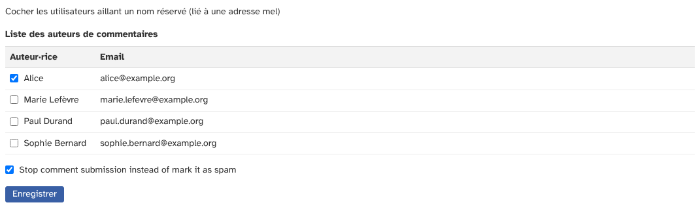

# whiteListCom : guide d'utilisation

whiteListCom ajoute deux filtres au plugin antispam de Dotclear :

* « Noms réservés » : empêche quelqu'un d'écrire un commentaire sous le nom d'une autre personne ;
* « Auteurs non modérés » : publie tout de suite les commentaires de personnes de confiance, même si les commentaires du blog sont modérés.

Le plugin n'a pas de page d'administration : ses deux filtres se règlent depuis la page « Antispam ». Il faut que le plugin antispam soit présent.

## Sommaire

* [Ouvrir les filtres](#ouvrir-les-filtres)
* [Réserver des noms](#réserver-des-noms)
* [Publier sans modération](#publier-sans-modération)
* [L'ordre des filtres](#lordre-des-filtres)
* [Bon à savoir](#bon-à-savoir)

## Ouvrir les filtres

1. Ouvrez « Antispam » dans le menu « Blog ».
2. Dans la liste des filtres, repérez « Noms réservés » et « Auteurs non modérés ». Ils sont actifs dès l'installation.
3. Cliquez sur l'icône de réglages à droite de la ligne du filtre voulu.

## Réserver des noms

Un nom réservé est associé à une adresse e-mail. Si un visiteur écrit un commentaire avec ce nom mais une autre adresse, il est refusé. Cela évite qu'on se fasse passer pour vous ou pour un de vos habitués.

La page liste les auteurs des commentaires déjà reçus sur le blog, avec leur adresse. Un auteur doit donc avoir déjà commenté pour pouvoir être réservé.

1. Ouvrez le filtre « Noms réservés ».
2. Cochez les auteurs dont le nom doit être réservé.
3. Choisissez ce qui se passe quand quelqu'un usurpe un nom, avec la case « Stop comment submission instead of mark it as spam » (cette phrase n'est pas traduite) :
   * cochée : le commentaire est refusé et le visiteur voit le message « Ce nom est réservé à un autre utilisateur. » ; rien n'est enregistré. C'est le réglage par défaut ;
   * décochée : le commentaire est enregistré comme indésirable, et le visiteur n'est pas prévenu.
4. Cliquez sur « Enregistrer ».

Le message « Le noms réservés ont été mis à jour. » confirme l'enregistrement.

Si l'auteur réservé écrit avec sa propre adresse, son commentaire suit les règles normales du blog.

## Publier sans modération

Ce filtre sert quand les commentaires du blog sont modérés : les commentaires des personnes cochées sont publiés tout de suite, sans attendre votre validation.

1. Ouvrez le filtre « Auteurs non modérés ».
2. Cochez les personnes de confiance, dans la liste des auteurs de billets ou dans celle des auteurs de commentaires.
3. Cliquez sur « Enregistrer ».

Le message « Les noms non modérés ont été mis à jour. » confirme l'enregistrement.

La personne est reconnue à son adresse e-mail seulement, pas à son nom. Les autres visiteurs restent modérés.

## L'ordre des filtres

Placez « Noms réservés » avant « Auteurs non modérés » dans la liste de l'antispam : le premier vérifie le couple nom et adresse, le second ne regarde que l'adresse. Sinon, quelqu'un qui connaît l'adresse d'une personne de confiance pourrait écrire sous un autre nom et être publié.

Pour changer l'ordre, glissez les lignes de la liste, puis enregistrez.

## Bon à savoir

* Les deux listes sont faites à partir des commentaires déjà reçus : une personne doit avoir écrit un commentaire avant de pouvoir être ajoutée.
* Si une personne a écrit sous plusieurs noms ou plusieurs adresses, elle apparaît une fois par couple nom et adresse.
* Les listes sont propres à chaque blog.
