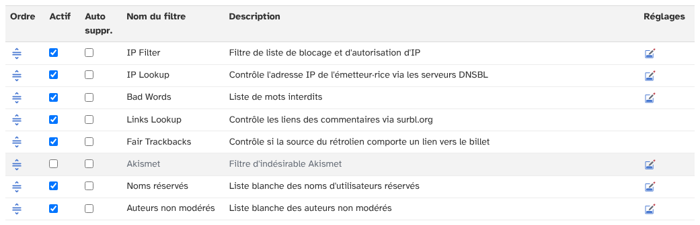
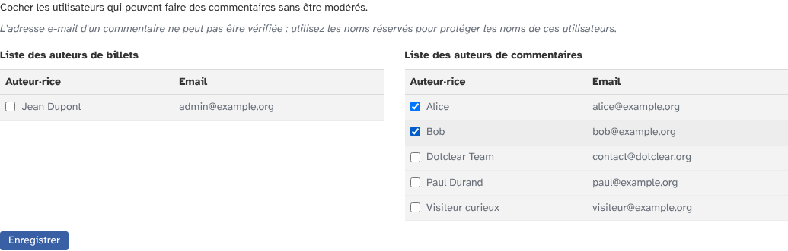

# whiteListCom : guide d'utilisation

whiteListCom ajoute deux filtres au plugin antispam de Dotclear :

* « Noms réservés » : empêche quelqu'un d'écrire un commentaire sous le nom d'une autre personne ;
* « Auteurs non modérés » : publie tout de suite les commentaires de personnes de confiance, même si les commentaires du blog sont modérés.

Le plugin n'a pas de page d'administration : ses deux filtres se règlent depuis la page « Antispam ». Il faut que le plugin antispam soit présent.

## Sommaire

* [Ouvrir les filtres](#ouvrir-les-filtres)
* [Réserver des noms](#réserver-des-noms)
* [Publier sans modération](#publier-sans-modération)
* [Bon à savoir](#bon-à-savoir)

## Ouvrir les filtres

1. Ouvrez « Antispam » dans le menu « Blog ».
2. Dans la liste des filtres, repérez « Noms réservés » et « Auteurs non modérés ». Ils sont actifs dès l'installation.
3. Cliquez sur l'icône de réglages à droite de la ligne du filtre voulu.

## Réserver des noms

Un nom réservé est associé à une adresse e-mail. Si un visiteur écrit un commentaire avec ce nom mais une autre adresse, il est refusé. Cela évite qu'on se fasse passer pour vous, pour un rédacteur du blog ou pour un de vos habitués.

La page liste les noms déjà réservés, les rédacteurs des billets et les auteurs des commentaires reçus, avec leur adresse. Les commentaires indésirables n'y figurent pas.

1. Ouvrez le filtre « Noms réservés ».
2. Cochez les noms à réserver.
3. Pour réserver un nom qui n'est pas dans la liste, saisissez-le dans « Réserver un nouveau nom : », avec son adresse dans « Avec l'adresse e-mail : ».
4. Choisissez ce qui se passe quand quelqu'un usurpe un nom, avec la case « Bloquer l'envoi du commentaire au lieu de le marquer comme indésirable » :
   * cochée (réglage par défaut) : le commentaire est refusé et le visiteur voit le message « Ce nom est réservé à un autre utilisateur. » ; rien n'est enregistré ;
   * décochée : le commentaire est enregistré comme indésirable, et le visiteur voit, comme pour tout indésirable, qu'il sera publié après validation.
5. Cliquez sur « Enregistrer ».

Le message « Les noms réservés ont été mis à jour. » confirme l'enregistrement.

Les noms sont comparés sans tenir compte des majuscules ni des espaces : « Jean  Dupont » et « jean dupont » sont le même nom. Les adresses sont comparées sans tenir compte des majuscules.

Si l'auteur réservé écrit avec sa propre adresse, son commentaire suit les règles normales du blog.

## Publier sans modération

Ce filtre sert quand les commentaires du blog sont modérés : les commentaires des personnes cochées sont publiés tout de suite, sans attendre votre validation.

1. Ouvrez le filtre « Auteurs non modérés ».
2. Cochez les personnes de confiance, dans la liste des auteurs de billets ou dans celle des auteurs de commentaires.
3. Cliquez sur « Enregistrer ».

Le message « Les noms non modérés ont été mis à jour. » confirme l'enregistrement.

La personne est reconnue à son adresse e-mail. Comme l'adresse d'un commentaire ne peut pas être vérifiée, ce filtre tient aussi compte des noms réservés : un commentaire n'est pas publié directement s'il utilise un nom réservé avec une autre adresse, ou une adresse réservée avec un autre nom. Réservez donc aussi le nom de vos personnes de confiance. Les autres visiteurs restent modérés.

## Bon à savoir

* Les filtres sont actifs dès l'installation, et le blocage des usurpateurs est activé par défaut.
* L'ordre des deux filtres dans la liste de l'antispam n'a pas d'importance : « Auteurs non modérés » vérifie lui-même les noms réservés.
* La liste des auteurs non modérés est faite à partir des auteurs de billets et des commentaires déjà reçus : un visiteur doit avoir écrit un commentaire avant de pouvoir y être ajouté.
* Si une personne a écrit sous plusieurs noms ou plusieurs adresses, elle apparaît une fois par couple nom et adresse.
* Les listes sont propres à chaque blog.
